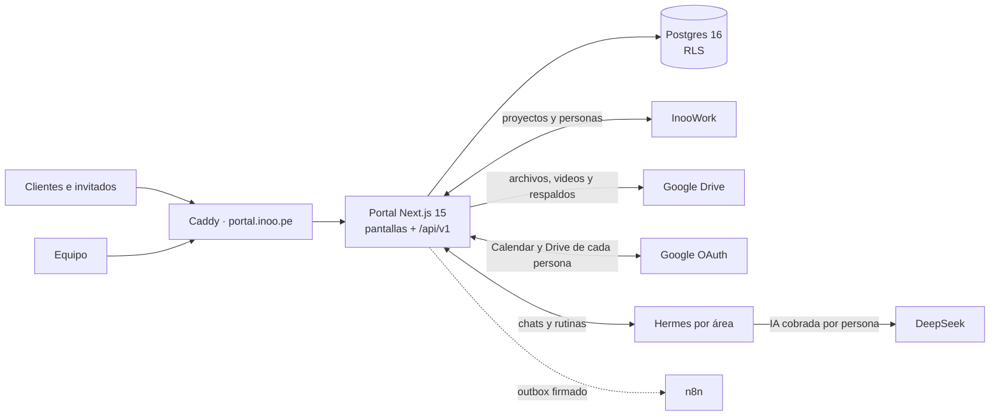

<p align="center">
  <picture>
    <source media="(prefers-color-scheme: dark)" srcset="apps/portal/public/marca/inoo-blanco.svg">
    
  </picture>
</p>

<h1 align="center">Oficina virtual de Inoo</h1>

<p align="center">
  El portal de clientes, el espacio del equipo y Jarvis, la IA de cada área, en una sola web app.<br>
  <strong>En producción desde el 6 nov 2026 en <a href="https://portal.inoo.pe">portal.inoo.pe</a></strong>, con usuarios reales.
</p>

<p align="center">
  <a href="https://github.com/EquipoTI-Inoo/oficina-virtual/actions/workflows/ci.yml"></a>
  
  
  
  
  
</p>

<p align="center">
  <a href="#-empezar-en-2-minutos">Empezar</a> ·
  <a href="#-qué-hace">Qué hace</a> ·
  <a href="#-cómo-está-hecho">Cómo está hecho</a> ·
  <a href="#-pruebas">Pruebas</a> ·
  <a href="#-documentación">Documentación</a> ·
  <a href="#-estado">Estado</a>
</p>

---

## 🚀 Empezar en 2 minutos

Sin base de datos: el portal usa una **API simulada** que cumple el mismo contrato que el backend real
(`docs/arquitectura/openapi.yaml`), con datos de prueba.

```bash
cd apps/portal
npm install
npm run dev            # http://localhost:3000
```

| Entra como | Correo | Contraseña | Qué ve |
|---|---|---|---|
| Cliente (administradora) | `valeria@casaoliva.pe` | `demo1234` | El portal de su empresa |
| Cliente (solo lectura) | `martin@casaoliva.pe` | `demo1234` | El portal, sin aprobar |
| Equipo · account manager y lead de CRM | `diego.castro@inoo.pe` | `demo1234` | Sus cuentas y proyectos |
| Equipo · Administración, super usuario | `admin@inoo.pe` | `demo1234` | Todo, con niveles, permisos y conectores |
| Equipo · Finanzas | `finanzas@inoo.pe` | `demo1234` | Todo lo de Administración y los pagos |
| Equipo por proyecto · desarrollo web | `camila.paredes@inoo.pe` | `demo1234` | Solo sus proyectos y sus marcas |

<details>
<summary><strong>Entorno completo con Docker</strong> (Postgres con semillas, Prism, Mailpit, MinIO)</summary>

```bash
cp infra/local/.env.example infra/local/.env
docker compose -f infra/local/docker-compose.yml up --build
```

Variables y backend real: [`docs/configuracion.md`](docs/configuracion.md).
</details>

## ✨ Qué hace

<table>
<tr>
<td width="33%" valign="top">

### 🏢 Clientes
- Inicio con lo que les toca hacer
- Sus servicios con avance por etapas
- Entregables y piezas para aprobar o pedir cambios
- Requerimientos con plazos en días hábiles
- Briefs, soporte y tickets
- Resumen del avance (opcional, sin mencionar la IA)

</td>
<td width="33%" valign="top">

### 👥 Equipo
- **Proyectos como Monday:** tablas, kanban, línea de tiempo, calendario, resumen y carga; 34 tipos de columna; automatizaciones; comentarios con @menciones; archivos con versiones y comentarios en un punto de la imagen o un segundo del video
- **Carpetas** empresa → marca → carpeta, con árbol y filtros
- **Compartir** como en Docs, también con invitados de afuera
- Mi panel, Mi trabajo, Por revisar, calendario con Google Calendar
- Empresas, Clientes, Organigrama y accesos por nivel

</td>
<td width="33%" valign="top">

### 🤖 Jarvis
- Bots de IA por área (y Gerencia) con chats que se guardan
- Skills, conectores MCP y cuentas propias (Drive, Calendar)
- Tareas automáticas: por horario y cuando pasa algo
- Biblioteca en Drive
- En Chrome: usa la pestaña que le prestas (ver, abrir, clic, escribir), con tu aprobación
- Nadie maneja llaves: el gasto se cobra a cada persona, con topes por área

</td>
</tr>
</table>

> **La IA no se nota para el cliente:** lo que genera Jarvis lo revisa y lo envía el equipo.

## 🧱 Cómo está hecho



| | |
|---|---|
| **Contrato primero** | `openapi.yaml` es la fuente: de ahí salen los tipos de TypeScript que usan el front y el back. La API simulada y el backend real lo cumplen igual, y una prueba lo verifica |
| **Seguridad en la base** | Cada pedido fija en Postgres quién llama y las políticas RLS filtran por cliente, aunque el código tuviera un error |
| **InooWork es la fuente** | Los tableros viven en InooWork; cada cambio relee el proyecto, aplica solo ese cambio y lo guarda |
| **Nada se pierde** | Los eventos de negocio van a un outbox en la misma transacción y se entregan a n8n con firma HMAC |
| **Sin llaves para el equipo** | Las cuentas personales se conectan con OAuth; el portal guarda solo el permiso, cifrado con AES-256-GCM |
| **Producción simple** | Un VPS con Docker Compose, Caddy y timers de systemd; respaldo antes de cada migración y uno diario a Drive |

**Stack:** Next.js 15 · React 19 · TypeScript · PostgreSQL 16 · Docker · Caddy · Node `node:test` · Playwright · PGlite · n8n · Hermes · DeepSeek.

## 🧪 Pruebas

```bash
cd apps/portal
npm run typecheck      # tipos
npm run test:api       # 577 pruebas: cada flujo contra la API simulada y contra Postgres (PGlite, con RLS)
npm run test:e2e       # 54 flujos de navegador + celular (Playwright)
```

El **CI** (GitHub Actions) corre tres trabajos en cada push a `main`:

| Trabajo | Qué revisa |
|---|---|
| `portal` | Tipos, pruebas de API, build de producción y pruebas de navegador |
| `base-de-datos` | Todas las migraciones en orden sobre un Postgres 16 limpio, semillas y comprobaciones |
| `contrato` | Validación del `openapi.yaml` con Redocly |

## 📚 Documentación

| Documento | Para qué |
|---|---|
| [`docs/operacion.md`](docs/operacion.md) | **Producción:** dónde vive cada cosa, cómo publicar, migraciones, procesos programados, respaldos, Jarvis, conexiones de Google y videos |
| [`docs/configuracion.md`](docs/configuracion.md) | Requisitos, variables de entorno, Docker local y backend real |
| [`docs/entorno-de-pruebas.md`](docs/entorno-de-pruebas.md) | API simulada, datos y usuarios de prueba, cuenta de pruebas en producción y pruebas automáticas |
| [`docs/arquitectura/arquitectura.md`](docs/arquitectura/arquitectura.md) | Arquitectura (estado real y diseño original), esquema de datos, flujos y seguridad |
| [`docs/arquitectura/openapi.yaml`](docs/arquitectura/openapi.yaml) | Contrato de la API |
| [`docs/diseno.md`](docs/diseno.md) | Marca, tokens y pantallas |
| [`docs/prd.md`](docs/prd.md) · [`docs/backlog-y-casos-de-uso.md`](docs/backlog-y-casos-de-uso.md) | Producto: objetivos, fases y casos de uso |

## 🗂️ Estructura

```
apps/portal/            Portal Next.js: pantallas (src/pantallas), dominio compartido (src/dominio),
                        backend real (src/servidor), API simulada (src/mock) y pruebas (tests/, e2e/)
database/migraciones/   Esquema de Postgres en migraciones numeradas (0001 a 0064)
database/semillas/      Datos de prueba
docs/                   Producto, arquitectura, diseño, configuración y operación
extensiones/            Jarvis para Chrome
infra/hostinger/        Producción: Compose, Caddy, respaldos y procesos programados
infra/local/            Entorno local con Docker
integrations/           Google y Drive (conectar cuentas), Hermes (MCP del portal), InooWork, Paid Media y WordPress
n8n/workflows/          Workflows de eventos y agentes de contenido
```

## 📍 Estado

<sub>Al 18 nov 2026</sub>

- **En producción:** todo el contrato sobre Postgres con RLS, ingreso propio con 2FA opcional, tableros como Monday
  con carpetas, invitados de afuera y videos en Drive, Jarvis en las seis áreas y la importación completa de Monday
  (337 tableros y 15.795 ítems).
- **Listo y esperando configuración:** Google Calendar y Drive personales. Falta juntar los correos de Google del
  equipo y crear el cliente OAuth web ([`docs/operacion.md`](docs/operacion.md) §6).
- **Pendiente:** herramientas de agenda para Jarvis, probar un video real en Drive y revisión legal de privacidad y
  términos.

<details>
<summary><strong>Cómo se trabaja en este repo</strong></summary>

1. **Contrato primero:** se cambia `openapi.yaml`, se regeneran los tipos (`src/api/tipos-api.ts`) y después se
   implementa en la API simulada y en el backend real.
2. **Migraciones numeradas** en `database/migraciones/`. En producción se aplican a mano con respaldo previo
   ([`docs/operacion.md`](docs/operacion.md) §4).
3. **Ninguna clave en el repositorio:** viven en el `.env` del servidor. Las plantillas van sin valores.
4. **Publicar:** `git pull` y reconstruir el contenedor del portal ([`docs/operacion.md`](docs/operacion.md) §3).

</details>
