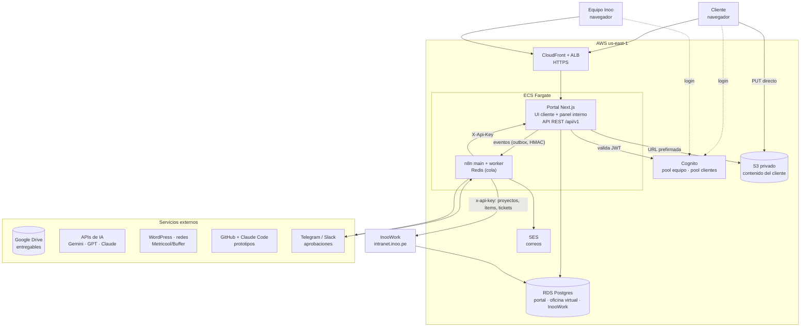
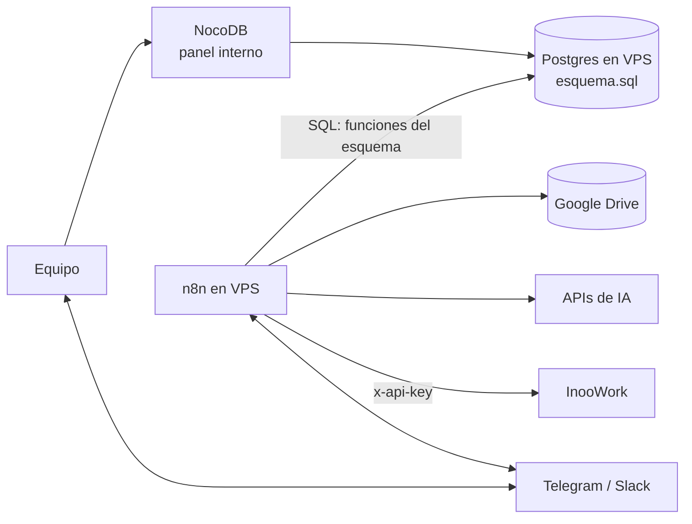
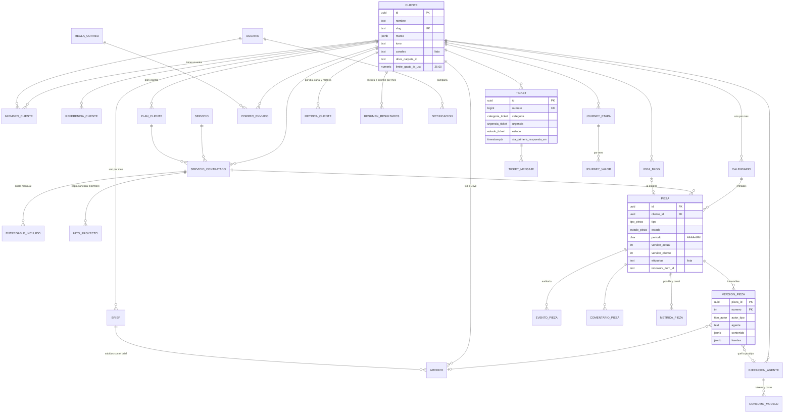
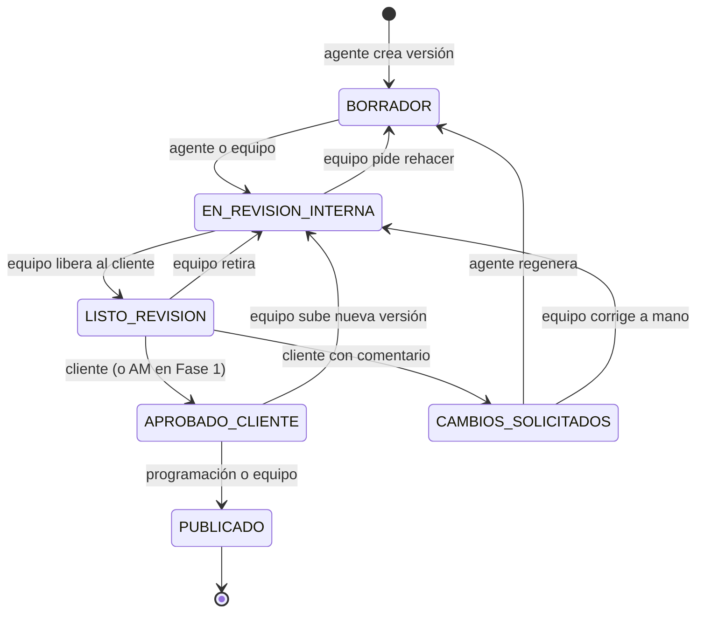
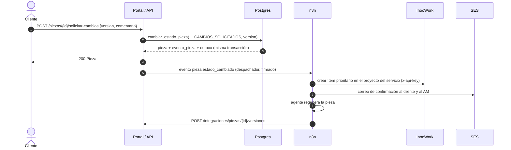
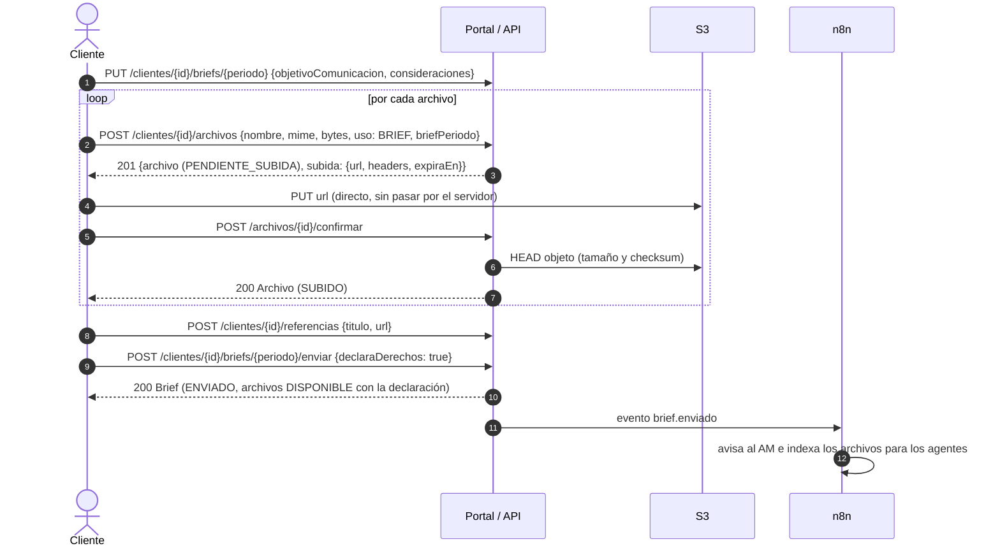
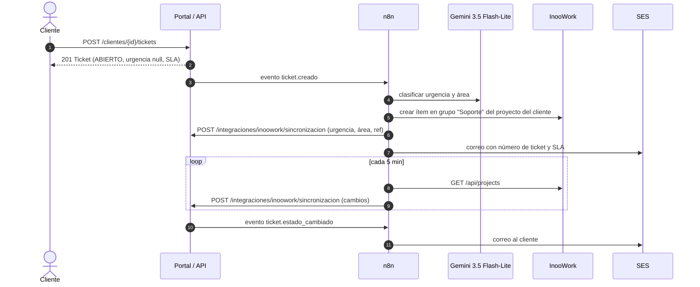

# Arquitectura y contratos de API — Oficina Virtual de IA y Portal de Clientes

Versión 1.1 · 6 oct 2026 (ajustada a las pantallas de Figma del portal; ver sección 8) · Basado en el PRD (3 oct 2026), el Backlog y Casos de Uso v1.0, la hoja de validación de proveedores y la `API_GUIDE.md` de InooWork (repo AppInoo, rama main).

Archivos de este paquete:

| Archivo | Para qué |
|---|---|
| `arquitectura.md` | Este documento: componentes, diagramas, flujos y decisiones |
| `esquema.sql` | Esquema Postgres 16 ejecutable (tablas, enums, reglas de estado, aislamiento por cliente). Probado en una base limpia |
| `openapi.yaml` | Contrato REST v1 (OpenAPI 3.1) para portal, panel interno y n8n. Valida con Redocly sin errores |
| `tipos-api.ts` | Tipos TypeScript generados del contrato, para importar en el portal Next.js |

---

## 1. Vista general (Fase 2, AWS)



**Idea central.** Una sola base de datos y una sola API con dos interfaces (cliente y equipo) separadas por permisos, como pide el PRD. La lógica de negocio (estados de piezas, visibilidad, auditoría) vive en la API y en la base; n8n orquesta agentes y sistemas externos, pero escribe a través de la API, nunca saltándose las reglas.

### Componentes

| Componente | Responsabilidad | Tecnología |
|---|---|---|
| Portal Next.js | UI del cliente, panel interno y API REST `/api/v1` (route handlers) en un mismo contenedor | Next.js + TypeScript, ECS Fargate (0,5 vCPU / 1 GB) |
| API `/api/v1` | Autenticación, permisos, reglas de estado, URLs firmadas, eventos | Implementa `openapi.yaml`; validación con el mismo esquema |
| Despachador outbox | Lee `outbox_evento` y entrega eventos a n8n con reintentos | Proceso ligero en el contenedor del portal (o tarea programada) |
| n8n (main + worker) | Agentes de IA, Drive, WordPress, redes, InooWork, correos SES, Telegram/Slack | n8n en queue mode con Redis |
| RDS Postgres | Datos del portal y la oficina virtual (`esquema.sql`) y, en esquema aparte, InooWork migrado | db.t4g.small, gp3 50 GB, backups diarios |
| S3 | Lo que sube el cliente (fotos, videos, documentos) | Bucket privado, SSE-S3, sin acceso público |
| Google Drive | Entregables producidos por agentes y equipo (estructura del PRD) | API de Drive desde n8n |
| Cognito | Login con dos user pools: equipo y clientes | Hosted UI o Amplify Auth en el portal |
| SES | Correos automáticos (RPA) | Plantillas HTML de marca |

### Fase 1 (Hostinger, interna) con el mismo modelo



En Fase 1 no hay portal ni API. n8n escribe en Postgres con SQL directo, pero los cambios de estado de piezas pasan por la función `cambiar_estado_pieza()`, que valida la transición, guarda la auditoría y deja el evento en el outbox. Por eso el mismo esquema sirve en las dos fases y la migración a RDS es un `pg_dump`/`pg_restore` sin transformar datos.

---

## 2. Esquema de datos

Detalle completo y ejecutable en `esquema.sql`. Diagrama de las entidades principales:



### Reglas que el esquema hace cumplir

- **Multi-cliente.** Toda tabla con datos de cliente tiene `cliente_id`. Además hay Row Level Security: la API fija `app.usuario_tipo` y `app.cliente_ids` por conexión, y un usuario CLIENTE no puede leer filas de otro cliente aunque la consulta tenga un error.
- **El cliente solo ve contenido revisado.** Ve todas sus piezas en listas y calendario (las que están en `BORRADOR` o `EN_REVISION_INTERNA` le llegan como `EN_PRODUCCION`, sin contenido), pero RLS le oculta toda versión que el equipo no le envió y los comentarios internos.
- **Transiciones de estado.** Solo las de la tabla `transicion_pieza`, y según quién actúa (servicio, equipo o cliente). Pasar a `LISTO_REVISION` solo lo puede hacer una persona del equipo (humano en el loop).
- **Trazabilidad.** Cada versión guarda autor (agente o persona), contenido, fuentes, archivo y la ejecución que la produjo. Cada cambio de estado deja un `evento_pieza` con usuario, canal y comentario.
- **Derechos de uso.** Un archivo de origen CLIENTE no se puede guardar sin la declaración, el usuario y la fecha.
- **Costos.** `consumo_modelo` registra tokens e imágenes por llamada; el costo se calcula con `tarifa_modelo` (incluye la subida de Gemini 3.8 Flash del 1 ene 2027). La vista `gasto_ia_mensual` da el gasto y el % del límite por cliente.

### Estados



Una aprobación vale solo para la versión aprobada: si el equipo sube una versión nueva después, la pieza vuelve a revisión y el cliente tiene que aprobarla otra vez (así lo muestra el detalle de pieza en Figma).

Para el cliente, `BORRADOR` y `EN_REVISION_INTERNA` se muestran como un único estado, `EN_PRODUCCION` («En producción»).

En Drive el prefijo del archivo sigue siendo solo `BORRADOR_` o `APROBADO_` (se renombra al pasar a `APROBADO_CLIENTE`); el estado detallado vive en la base.

Calendario: `PROPUESTO → CAMBIOS_SOLICITADOS → PROPUESTO (nueva versión) → APROBADO_PLAN`.
Ticket: `ABIERTO → EN_PROCESO ⇄ ESPERANDO_CLIENTE → RESUELTO → CERRADO` (el cliente puede reabrir un RESUELTO durante 7 días).

---

## 3. Contrato de API (resumen para frontend)

Contrato completo con esquemas y ejemplos en `openapi.yaml`. Tipos listos para importar en `tipos-api.ts`.

### Convenciones

| Tema | Regla |
|---|---|
| Base | `https://clientes.inoo.pe/api/v1` (dominio propuesto, pendiente de confirmar) |
| Formato | JSON en camelCase; fechas ISO 8601 en UTC; periodos `AAAA-MM`; IDs UUID |
| Auth | `Authorization: Bearer <JWT Cognito>`; `GET /me` dice quién es y a qué clientes accede |
| Listas | Cursor: `?limite=20&cursor=…` → `{ datos, paginacion: { siguienteCursor } }` |
| Errores | `application/problem+json` con `codigo` estable (`VERSION_DESACTUALIZADA`, `SIN_PERMISO`, `VALIDACION`…) y `errores[]` por campo |
| Botones | Cada pieza trae `acciones[]` con lo que el usuario actual puede hacer. El frontend pinta botones según esa lista, no según el estado |
| Reintentos | Aprobar, pedir cambios, crear ticket y subir archivo aceptan `Idempotency-Key` |
| Concurrencia | Aprobar y pedir cambios envían la `version` que el cliente vio; si cambió, 409 |
| Visibilidad | 404 tanto si no existe como si es de otro cliente; los campos "solo equipo" no se envían a clientes |

### Endpoints por pantalla

En la columna Equipo, "Mismos endpoints" significa que el equipo llama exactamente a los mismos endpoints que el cliente; la API le devuelve además los campos marcados "solo equipo" y no le aplica el filtro de visibilidad. Un "+" indica endpoints adicionales que solo usa el equipo, además de los del cliente.

| Pantalla (Figma) | Cliente | Equipo |
|---|---|---|
| Barra superior y menú | `GET /me` (usuario, cuentas, `notificacionesSinLeer`), `GET /me/notificaciones`, `POST /me/notificaciones/leer`; contador del menú = `indicadores.porAprobar` de Inicio | Mismos endpoints |
| Inicio | `GET /clientes/{id}/inicio` (indicadores, plan, avance del mes, pendientes, servicios, próxima publicación, tickets abiertos) | Mismos endpoints |
| Servicios contratados | `GET /clientes/{id}/servicios` (plan, resumen del mes y todo el catálogo con contratados y no contratados), `GET /clientes/{id}/plan/contrato` | + `POST /clientes/{id}/servicios`, `GET /servicios` |
| Entregables por revisar | `GET /clientes/{id}/piezas?estado=LISTO_REVISION&canal=&q=&periodo=` (trae `total` y `conteos`) | Mismos endpoints |
| Detalle de pieza | `GET /piezas/{id}`, `GET /piezas/{id}/versiones` (historial con la decisión de cada versión), `POST /piezas/{id}/aprobar`, `POST /piezas/{id}/solicitar-cambios`, `GET/POST /piezas/{id}/comentarios`, `GET /piezas/{id}/descarga` | + `POST /piezas/{id}/transiciones`, `POST /piezas/{id}/versiones`, `PATCH /piezas/{id}` |
| Blog | `GET /clientes/{id}/ideas-blog?periodo=` (ideas con palabra clave y ángulo, y `cupo`), `POST /clientes/{id}/ideas-blog/seleccion`, `GET /clientes/{id}/piezas?tipo=BLOG` | Mismos endpoints |
| Calendario del mes | `GET /clientes/{id}/calendario/{periodo}?servicioContratadoId=` | + `…/aprobar`, `…/solicitar-cambios` |
| Brief y referencias | `GET/PUT /clientes/{id}/briefs/{periodo}`, `POST /clientes/{id}/archivos` (uso `BRIEF`) → PUT a S3 → `POST /archivos/{id}/confirmar`, `GET/POST/DELETE /clientes/{id}/referencias`, `POST /clientes/{id}/briefs/{periodo}/enviar` (firma los derechos) | + `GET /clientes/{id}/briefs`, `POST …/confirmar` |
| Resultados | `GET /clientes/{id}/reportes/resultados` (indicadores, canales, recorrido y lectura), `GET /clientes/{id}/reportes/informe?periodo=` | Mismos endpoints |
| Avance de proyectos | `GET /clientes/{id}/avance?periodo=` | Mismos endpoints |
| Soporte | `GET /clientes/{id}/tickets?grupo=&q=` (trae `conteos`), `POST /clientes/{id}/tickets` (adjunto con uso `ADJUNTO_TICKET`), `GET/PATCH /tickets/{id}`, `POST /tickets/{id}/mensajes` | Mismos endpoints (la gestión del ticket ocurre en InooWork) |
| Panel general | — | `GET /panel/clientes?q=&estadoOperativo=&periodo=` (resumen de la agencia y filas), `GET /panel/clientes/exportar` (CSV) |
| Bandeja de producción | — | `GET /panel/piezas?clienteId=&periodo=&servicioContratadoId=&origen=`, `POST /clientes/{id}/piezas` ("Nueva pieza") |
| Ficha de cliente | — | `GET /clientes/{id}`, `PATCH /clientes/{id}` ("Editar ficha"), `GET /clientes/{id}/referencias`, `GET /clientes/{id}/servicios`, `GET /clientes/{id}/actividad` |
| Sin pantalla en Figma todavía | `GET /clientes/{id}/biblioteca-paid`, `GET /clientes/{id}/correos-automaticos`, `/clientes/{id}/miembros` | `GET /panel/costos-ia`, `GET /panel/ejecuciones` |

Integraciones (no las usa el frontend): `POST /integraciones/ejecuciones`, `/integraciones/piezas`, `/integraciones/piezas/{id}/versiones`, `/integraciones/calendarios`, `/integraciones/inoowork/sincronizacion`, `POST /webhooks/inoowork`. Eventos salientes hacia n8n en la sección `webhooks` del contrato.

### Ejemplo: aprobar una pieza

```http
POST /api/v1/piezas/1a2b3c4d-5e6f-4a7b-8c9d-0e1f2a3b4c5d/aprobar
Authorization: Bearer eyJ…
Idempotency-Key: 0b8f2c1e-7d1a-4f0e-9c55-3e2a1b7c9d10
Content-Type: application/json

{ "version": 2, "comentario": "Perfecto, publíquenlo" }
```

```json
200 OK
{
  "id": "1a2b3c4d-5e6f-4a7b-8c9d-0e1f2a3b4c5d",
  "tipo": "BLOG",
  "titulo": "5 errores al elegir un CRM",
  "periodo": "2026-11",
  "estado": "APROBADO_CLIENTE",
  "versionCliente": 2,
  "acciones": ["COMENTAR", "DESCARGAR"],
  "...": "resto de Pieza"
}
```

```json
409 Conflict  (Content-Type: application/problem+json)
{
  "type": "https://clientes.inoo.pe/errores/version-desactualizada",
  "title": "La pieza cambió mientras la revisabas",
  "status": 409,
  "codigo": "VERSION_DESACTUALIZADA",
  "detail": "Estás aprobando la versión 2 pero la vigente es la 3."
}
```

### Contenido de una versión según el tipo

`version.contenido` es una unión discriminada por `tipo`:

| `tipo` | Campos |
|---|---|
| `BLOG` | `tituloSeo`, `metaDescripcion`, `slug`, `cuerpoMd`, `palabras` |
| `COPY`, `ANUNCIO` | `red`, `copy`, `hashtags[]`, `cta`, `sugerenciaVisual`, `enfoque` |
| `ESTATICO`, `CARRUSEL`, `PORTADA` | `formato`, `imagenes[{archivoId, orden, textoEnImagen, url}]`, `copyAsociado` |
| `GUION`, `SHOTLIST`, `STORYBOARD` | `objetivo`, `gancho`, `cta`, `duracionSeg`, `escenas[{tiempo, tipoPlano, angulo, audio, indicacionVisual, locacion}]` |
| `PROTOTIPO_WEB` | `vistaPreviaUrl`, `secciones[]` (+ `repositorio`, `pullRequestUrl` solo equipo) |

---

## 4. Flujos clave

### Aprobación desde el portal (CU-06)



### Brief y contenido del cliente (CU-05)



### Ticket de soporte (CU-07)



---

## 5. Seguridad

- **Dos pools de Cognito** (equipo y clientes), como pide INO-01. El portal acepta tokens de ambos; el `sub` se mapea a `usuario.cognito_sub`. MFA opcional para clientes y obligatorio para ADMIN.
- **Autorización en dos capas**: la API comprueba rol y membresía en cada endpoint (`x-roles` en el contrato) y la base aplica RLS por `cliente_id` como red de seguridad.
- **Integraciones**: API keys con scopes (`piezas:write`, `ejecuciones:write`, `inoowork:sync`), guardadas solo como hash. Eventos salientes y webhooks entrantes firmados con HMAC-SHA256 y marca de tiempo (rechazo si tienen más de 5 minutos).
- **Archivos**: bucket privado; subidas y descargas solo por URL prefirmada de 15 minutos; validación de MIME y tamaño (100 MB para archivos del brief, 10 MB para adjuntos de tickets, como indican las pantallas).
- **InooWork (INO-00)**: antes de conectar, desplegar el parche de seguridad (token en toda la API, API key) y cambiar la contraseña del admin. La API key de integración no debe ir por query string (`?api_key=`), solo por header, para que no quede en logs.
- **Auditoría**: `evento_pieza` registra quién aprobó qué y por qué canal; los archivos del cliente guardan quién declaró los derechos y cuándo.

---

## 6. Decisiones tomadas por defecto

Donde los documentos no lo definían, elegí lo siguiente. Todas son fáciles de cambiar ahora y más caras después del Sprint 5.

| # | Decisión | Por qué |
|---|---|---|
| 1 | La API vive dentro del mismo contenedor Next.js (`/api/v1`) | El Excel de AWS presupuesta un solo contenedor de portal; el contrato OpenAPI permite separarla después sin tocar el frontend |
| 2 | n8n escribe a través de la API en Fase 2 (con API key), no con SQL directo | Las reglas de estado y la auditoría quedan en un solo lugar |
| 3 | Transactional outbox + despachador para avisar a n8n | Un evento nunca se pierde ni se envía sin que el cambio se haya guardado |
| 4 | Sincronización con InooWork por consulta cada 5 minutos | InooWork hoy no emite webhooks y solo tiene `GET /api/projects` (todos) y `PUT` del proyecto completo. El endpoint `/webhooks/inoowork` queda definido para cuando existan |
| 5 | El portal muestra una copia saneada de InooWork (`hito_proyecto`), nunca lee InooWork en vivo | Sin notas internas, sin depender de la disponibilidad de InooWork, y rápido |
| 6 | Customer journey como etapas definidas por el equipo; cada etapa toma su valor de una métrica diaria (Meta, GA4, CRM) o de un valor manual | Es pregunta abierta en el PRD; la pantalla de Resultados de Figma usa datos reales del periodo, y esta forma admite las dos respuestas |
| 7 | Dominio `clientes.inoo.pe` | Es el ejemplo del PRD; pendiente de confirmar |
| 8 | Tres roles dentro de cada cliente: ADMIN_CLIENTE, APROBADOR, LECTOR | POR-01 pide "permisos por usuario" sin detallarlos |
| 9 | El AM puede aprobar en nombre del cliente (canal PANEL/TELEGRAM/SLACK) | Necesario en Fase 1 (APR-01), y queda auditado con su usuario |
| 10 | Al superar el 100 % del límite de IA, la API responde `bloquear: true` y n8n pausa lo no crítico | El PRD solo define la alerta al 80 %; esto evita pasarse sin cortar trabajo en curso |
| 11 | Campos y rutas en español, camelCase en JSON y snake_case en la base | Coherente con el vocabulario del PRD (`cliente_id`, estados) |

### Riesgos técnicos detectados

- **InooWork guarda cada proyecto como un JSON y se actualiza con `PUT` del objeto completo.** Si n8n y una persona editan el mismo proyecto a la vez, uno pisa al otro. Conviene que el parche de InooWork agregue endpoints por ítem (`POST/PATCH /api/projects/{id}/items`) antes del Sprint 3 (US-15).
- **Sin `GET /api/projects/{id}`**, cada sincronización baja todos los proyectos. Funciona con pocos clientes; con más de 30 conviene un endpoint por id o por fecha de cambio.

---

## 8. Cambios de la v1.1 tras cruzar con Figma (6 oct 2026)

Revisé las 16 pantallas de escritorio del archivo de Figma frente a la v1.0. Esto es lo que las pantallas necesitaban y el contrato no tenía, y cómo quedó:

| Pantalla | Faltaba | Cambio |
|---|---|---|
| Barra superior | Campana de notificaciones | Tabla `notificacion`, `GET /me/notificaciones`, `POST /me/notificaciones/leer`, `notificacionesSinLeer` en `/me` |
| Inicio | Avance del mes (12 de 20, 60 %), en producción, próxima publicación, tarjetas de pendientes, servicios con cantidad por mes, tickets abiertos | `InicioCliente` rehecho para pintar la pantalla en una llamada |
| Servicios contratados | Plan ("Plan Crecimiento · Contrato hasta…"), "Ver contrato", servicios no contratados, unidad (artículos, diseños), progreso por servicio | Tabla `plan_cliente`, catálogo con `unidad` y descripción; categorías alineadas a Figma (Blog, Redes sociales, Estáticos, Audiovisual, Paid media, Web, CRM); `ServiciosCliente`; `GET /clientes/{id}/plan/contrato` |
| Entregables | Búsqueda, filtro por canal, total | `q`, `canal`, `paginacion.total` y `conteos` |
| Detalle de pieza | El cliente ve el historial de versiones con quién aprobó cada una; una versión nueva después de aprobar vuelve a revisión; etiquetas de cada imagen del carrusel ("Portada · 1 de 3") | `GET /piezas/{id}/versiones` abierto al cliente (solo versiones enviadas, con `decision`, `enviadaPor`); transición `APROBADO_CLIENTE → EN_REVISION_INTERNA`; `etiqueta` en imágenes |
| Blog | Palabra clave y ángulo de cada idea; selección en lote con cupo ("1 de 1 seleccionada", "Confirmar selección"); piezas en producción visibles | `palabraClave`, `angulo`, `cupo`; `POST /ideas-blog/seleccion` reemplaza a la decisión por idea; estado `EN_PRODUCCION` para el cliente |
| Calendario | Piezas en producción y filtro por servicio | `EN_PRODUCCION` y `servicioContratadoId` |
| Brief y referencias | El brief lo llena el cliente ("El enfoque de este mes"), sube archivos y enlaces, y firma los derechos una sola vez al enviar | Brief con `objetivoComunicacion`, `consideraciones`, estados BORRADOR → ENVIADO → CONFIRMADO; archivos en estado `SUBIDO` hasta el envío; `POST …/enviar`; límite de 100 MB |
| Resultados | Indicadores de sitio (visitas, contactos, conversión), visitas por canal con variación frente al periodo anterior, embudo con % sobre la etapa anterior, lectura del equipo, informe PDF | Tabla `metrica_cliente`, `resumen_resultados`; `ReporteResultados` rehecho; `GET …/reportes/informe`; el endpoint de journey se fusionó en resultados |
| Avance de proyectos | Hitos mensuales con rango de fechas, "Tu siguiente paso", siguiente paso con responsable, % aprobado | Campos en `hito_proyecto` y `servicio_contratado`; `GET /clientes/{id}/avance` |
| Soporte | Número tipo #1042, pestañas con conteo, búsqueda, línea de estado ("Diego Castro está revisando…"), adjunto de 10 MB sin declaración de derechos | Numeración desde 1001 y `codigo: "#1042"`; `grupo`, `q`, `conteos`, `resumenEstado`; uso `ADJUNTO_TICKET` |
| Panel general | KPIs de agencia, estado (En curso, Atención, Al día), contacto principal, alerta de IA, búsqueda, exportar | `ResumenAgencia`, `EstadoOperativo`, `contacto_principal_id`, `GET /panel/clientes/exportar` |
| Bandeja de producción | Tablero por columnas, origen (agente o persona), nota de estado, "Nueva pieza" | `GET /panel/piezas`, `origen`, `notaEstado`, `POST /clientes/{id}/piezas` |
| Ficha de cliente | Mensaje central, campaña, tono con etiquetas y ejemplo, público e intereses, paleta de referencias, enlace a Drive, historial de la cuenta | `Marca`, `Tono`, `Publico` estructurados; `paleta` en referencias; `driveUrl`; `GET /clientes/{id}/actividad` |

### Para revisar con diseño

- **Nombres de estado.** El calendario usa «Borrador» y «En revisión», mientras que el resto del portal usa «En producción» y «Listo para revisión» para lo mismo. La API usa `EN_PRODUCCION` y `LISTO_REVISION`; conviene unificar las etiquetas.
- **Límites de IA.** El panel muestra límites distintos por cliente (US$ 60, 80, 100), mientras que el PRD fija US$ 25. El modelo ya permite un límite por cliente; falta confirmar cuál es el valor por defecto.
- **"Contactar a mi equipo".** No está claro si abre un ticket, un correo o WhatsApp. Por ahora la API entrega nombre y correo del responsable de cuenta.
- **Pantallas que faltan.** Biblioteca de paid media, correos automáticos, usuarios del cliente, la lista de clientes del equipo y la vista de costos de IA tienen endpoints pero no tienen diseño.

## 7. Próximos pasos sugeridos

1. Revisar con frontend el contrato y las decisiones de la sección 6.
2. Aplicar `esquema.sql` en el Postgres del VPS (Sprint 1) y conectar NocoDB.
3. Generar mocks desde `openapi.yaml` (por ejemplo Prism) para que el portal avance en paralelo al backend.
